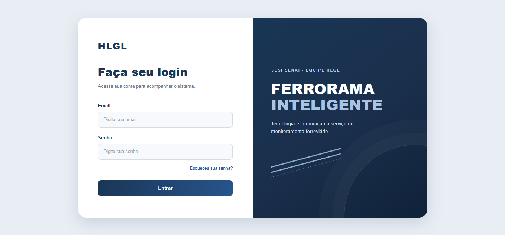
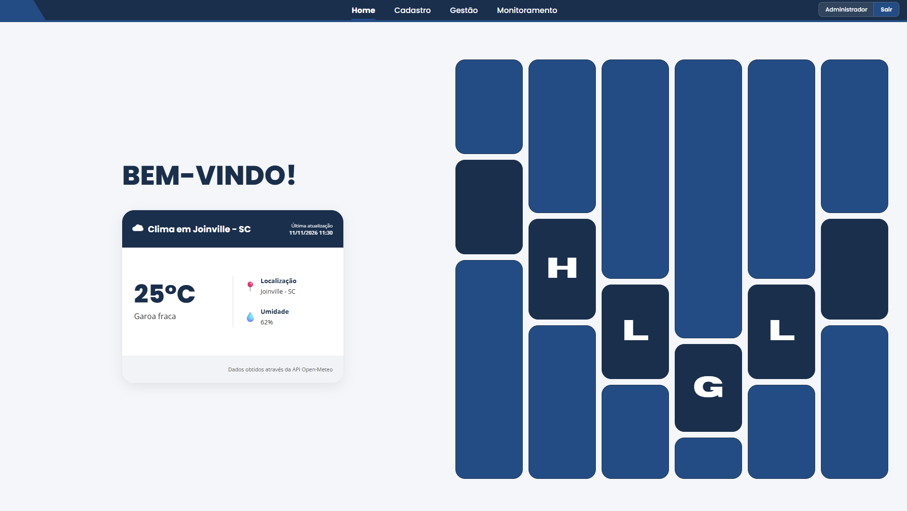
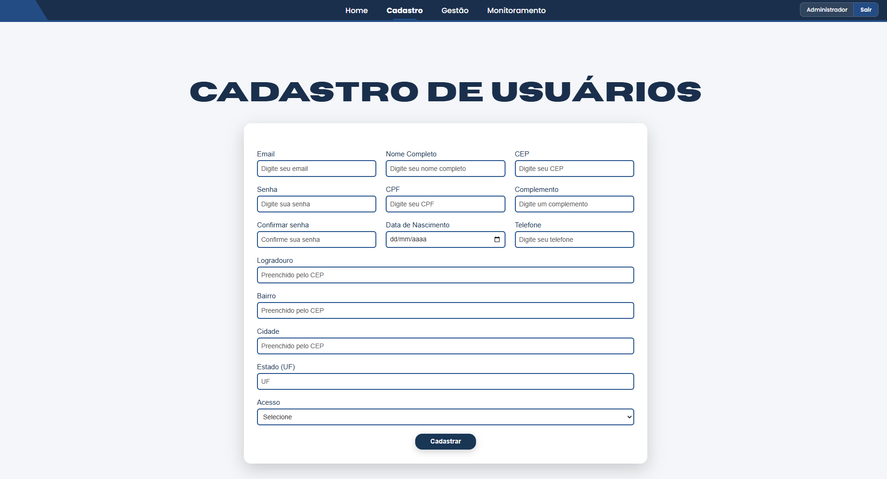
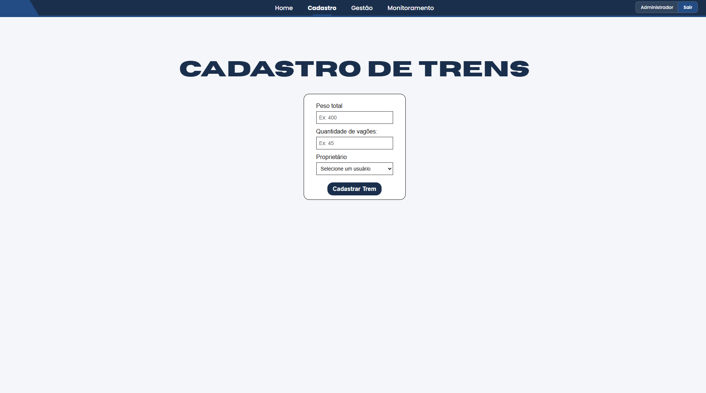
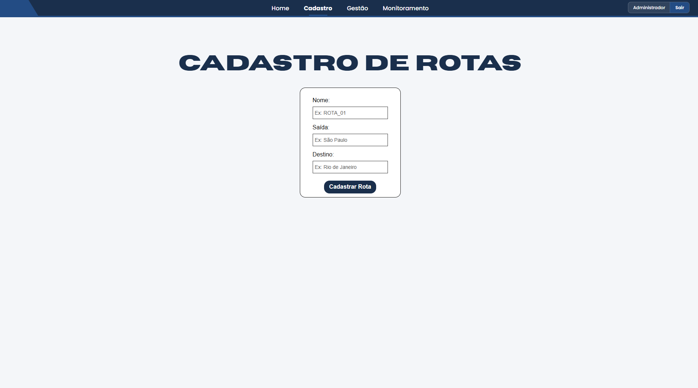
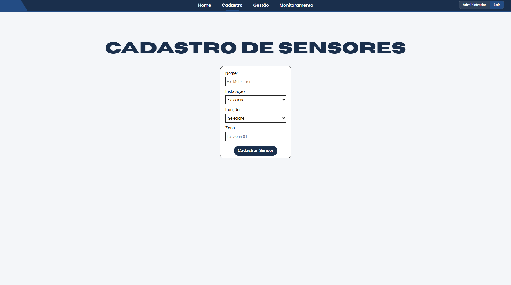

# Manual Rápido de Utilização — SA-Ferrorama

Guia para quem nunca usou o sistema. Em poucos minutos você aprende a entrar, navegar e realizar as principais operações.

---

## Sumário

1. [O que é o SA-Ferrorama](#1-o-que-é-o-sa-ferrorama)
2. [Como acessar o sistema](#2-como-acessar-o-sistema)
3. [Login e logout](#3-login-e-logout)
4. [Conhecendo a tela inicial (Home)](#4-conhecendo-a-tela-inicial-home)
5. [Como navegar](#5-como-navegar)
6. [Usuários](#6-usuários)
7. [Trens](#7-trens)
8. [Rotas](#8-rotas)
9. [Sensores](#9-sensores)
10. [Monitoramento e relatórios](#10-monitoramento-e-relatórios)
11. [O que só o administrador pode fazer](#11-o-que-só-o-administrador-pode-fazer)
12. [Como interpretar as informações da tela](#12-como-interpretar-as-informações-da-tela)
13. [Mensagens do sistema](#13-mensagens-do-sistema)
14. [Problemas comuns](#14-problemas-comuns)

---

## 1. O que é o SA-Ferrorama

Sistema de gestão ferroviária da equipe **HLGL** que reúne em um só lugar o cadastro e a consulta de **usuários, trens, rotas, sensores e relatórios**, além de uma tela de monitoramento e das condições do clima na região da operação (Joinville - SC).

Existem dois perfis de acesso:

- **Administrador:** gerencia todo o sistema.
- **Funcionário:** consulta a operação e realiza as tarefas liberadas para o seu perfil (veja a [seção 11](#11-o-que-só-o-administrador-pode-fazer)).

## 2. Como acessar o sistema

1. Abra o navegador (Chrome, Edge ou Firefox).
2. Digite o endereço: `http://localhost/sa-ferrorama/`
3. A página de apresentação do HLGL aparece. Clique em **Acesse o Sistema** (canto superior direito) ou em **Acessar sistema** (final da página).
4. A tela de login é exibida.

> Na estação de demonstração, o sistema já fica aberto nesta página.

## 3. Login e logout

### Entrar

1. Na tela **Faça seu login**, preencha **Email** e **Senha**.
2. Clique em **Entrar**.
3. Você é levado à tela **Home**.

Se o email ou a senha estiverem incorretos, o sistema exibe **"Email ou senha incorretos!"** e não permite o acesso. Se algum campo ficar vazio, aparece **"Preencha todos os campos!"**.

### Esqueci minha senha

Na tela de login, clique em **Esqueceu sua senha?**, digite o email da conta e clique em **Recuperar sua conta**. O sistema informa se a conta existe e orienta a procurar o suporte. Use **Voltar para o login** para retornar.

### Sair

Clique em **Sair**, no canto superior direito, ao lado do seu nome. A sessão é encerrada e você volta à página de apresentação. Sempre saia ao terminar o uso.

## 4. Conhecendo a tela inicial (Home)

A Home recebe você com a mensagem **BEM-VINDO!**, mostra o **clima em Joinville - SC** e dá acesso a todas as áreas do sistema pelo menu superior.

| Nº | Elemento | Para que serve |
|----|----------|----------------|
| 1 | Menu superior (Home, Cadastro, Gestão, Monitoramento) | Acessar todas as áreas do sistema |
| 2 | Seu nome e botão **Sair** (canto direito) | Ver quem está logado e encerrar a sessão |
| 3 | Cartão **Clima em Joinville - SC** | Mostrar temperatura, condição do tempo e umidade |
| 4 | Mosaico com as letras **H L G L** | Identidade visual da equipe HLGL |

## 5. Como navegar

O menu fica no topo de todas as telas e tem **dois grupos** com submenus. Passe o mouse sobre **Cadastro** ou **Gestão** para abrir as opções.

| Menu | O que abre |
|------|-----------|
| **Home** | Tela inicial com o clima |
| **Cadastro** | Formulários para criar novos registros: Sensores, Trens, Rotas, Relatórios e Usuários |
| **Gestão** | Listagens com os registros já cadastrados: Sensores, Trens, Rotas, Relatórios e Usuários |
| **Monitoramento** | Tela de monitoramento dos trens (em construção) |

- Para **cadastrar** algo novo, use **Cadastro**.
- Para **consultar, editar, ativar, desativar ou excluir**, use **Gestão**.
- O item do menu em que você está fica destacado.
- Para voltar a uma tela anterior, basta escolher outra opção no menu.

> O perfil **Funcionário** não vê todas as opções do menu (veja a [seção 11](#11-o-que-só-o-administrador-pode-fazer)).

## 6. Usuários

### Cadastrar (administrador)

1. No menu, clique em **Cadastro → Usuários**.
2. Preencha os campos do formulário **Cadastro de usuários**:
   - **Email**
   - **Senha** (mínimo de 8 caracteres, com pelo menos uma letra e um número)
   - **Confirmar senha**
   - **Nome Completo**
   - **CPF**
   - **Data de Nascimento** (não pode ser uma data futura)
   - **CEP** (ao informar um CEP válido, **Logradouro**, **Bairro**, **Cidade** e **Estado (UF)** são preenchidos automaticamente)
   - **Complemento**
   - **Telefone**
   - **Acesso** (**Funcionário** ou **Administrador**)
3. Clique em **Cadastrar**.
4. Uma mensagem confirma o cadastro. Se algum dado estiver incorreto, o sistema indica o que corrigir.

### Consultar

Clique em **Gestão → Usuários**. A tabela **Gestão de Usuários** mostra **Usuários** (nome), **ID**, **Email** e **Telefone**.

### Editar e excluir (administrador)

Na listagem, use:

- **Atualizar:** abre o formulário **Editar usuário** para alterar os dados. Ao terminar, salve.
- **Excluir:** abre uma janela de confirmação (**Excluir usuário?**). Clique em **Excluir** para confirmar ou em **Cancelar** para desistir.

Um usuário que já está vinculado a trens ou relatórios **não pode ser excluído**. O sistema avisa com a mensagem *"Não é possível excluir este usuário porque ele possui registros relacionados."*

## 7. Trens

### Cadastrar (administrador)

1. Menu **Cadastro → Trens**.
2. No formulário **Cadastro de Trens**, preencha:
   - **Peso total** (exemplo: 400)
   - **Quantidade de vagões** (exemplo: 45)
   - **Proprietário** (escolha o usuário responsável pelo trem na lista)
3. Clique em **Cadastrar Trem**.
4. Aparece a mensagem **"Trem cadastrado com sucesso!"**.

### Consultar

Clique em **Gestão → Trens**. A tabela **Gestão de Trens** mostra **ID**, **ID_Usuários** (responsável), **Peso**, **Quantidade de Vagões**, **Status** e **Rota**. Se o trem ainda não tem rota, aparece **"Sem rota cadastrada"**.

### Outras ações (administrador)

Na coluna **Ações**:

- Trem **Ativo:** o botão disponível é **Desativar**.
- Trem **Inativo:** ficam disponíveis **Atualizar**, **Ativar** e **Excluir**.

Ou seja, para editar ou excluir um trem, **desative-o primeiro**. Em **Atualizar** (tela **Editar Trem**) é possível alterar peso, vagões, proprietário e **vincular o trem a uma rota** (campo **Rota**).

Cada ação pede confirmação ("Tem certeza que deseja…?"). Um trem com registros relacionados pode não poder ser excluído; nesse caso o sistema exibe um aviso.

## 8. Rotas

### Cadastrar (administrador)

1. Menu **Cadastro → Rotas**.
2. No formulário **Cadastro de Rotas**, preencha:
   - **Nome** (exemplo: ROTA_01)
   - **Saída** (exemplo: São Paulo)
   - **Destino** (exemplo: Rio de Janeiro)
3. Clique em **Cadastrar Rota**.
4. Aparece a mensagem **"Rota cadastrada com sucesso!"**.

### Consultar

Clique em **Gestão → Rotas**. A tabela **Gestão de Rotas** mostra **ID**, **Nome**, **Saída**, **Destino** e **Status**.

### Outras ações (administrador)

Funciona como nos trens: rota **Ativa** permite **Desativar**; rota **Inativa** permite **Atualizar** (tela **Editar Rota**), **Ativar** e **Excluir**. O vínculo entre trem e rota é feito na edição do trem. Uma rota vinculada a trens não pode ser excluída enquanto houver registros relacionados.

## 9. Sensores

### Cadastrar

1. Menu **Cadastro → Sensores**.
2. No formulário **Cadastro de Sensores**, preencha:
   - **Nome** (exemplo: Motor Trem)
   - **Instalação:** **Trem** ou **Ferrovia**
   - **Função:** **Velocidade**, **Temperatura**, **Falhas** ou **Gasolina**
   - **Zona** (exemplo: Zona 01)
3. Clique em **Cadastrar Sensor**.
4. Aparece a mensagem **"Sensor cadastrado com sucesso!"**.

### Consultar

Clique em **Gestão → Sensores**. A tabela **Gestão de Sensores** mostra **ID**, **Nome**, **Instalação**, **Função**, **Zona** e **Status** (Ativo ou Inativo).

### Outras ações

Sensor **Ativo** permite **Desativar**; sensor **Inativo** permite **Atualizar** (tela **Editar Sensor**, onde também se altera o **Status**), **Ativar** e **Excluir**. Cada ação pede confirmação.

## 10. Monitoramento e relatórios

### Monitoramento

1. No menu, clique em **Monitoramento**.
2. A tela mostra uma ilustração animada de um trem percorrendo a ferrovia e o aviso **"Página em construção"**.
3. Os cartões **Trens em operação**, **Estações** e **Alertas** aparecem com **"--"** e a nota **"Disponível em breve"**.

Nesta versão, o monitoramento é apenas uma prévia visual: ainda não há consulta por trem nem gráficos de desempenho.

### Relatórios

**Cadastrar:** menu **Cadastro → Relatórios**. Escreva o texto no campo **Escreva seu relatório**, escolha o **Usuário relacionado** e clique em **Cadastrar**.

**Consultar:** menu **Gestão → Relatórios**. A tabela **Gestão de Relatórios** mostra **ID**, **Relatório** (o texto completo), **Usuário** e **Ações**.

**Editar e excluir:** use **Atualizar** (tela **Editar Relatório**) ou **Excluir** (com confirmação).

## 11. O que só o administrador pode fazer

| Funcionalidade | Administrador | Funcionário |
|----------------|:-------------:|:-----------:|
| Entrar e sair do sistema | ✅ | ✅ |
| Ver a Home e o clima | ✅ | ✅ |
| Acessar o Monitoramento | ✅ | ✅ |
| Consultar trens e rotas (Gestão) | ✅ | ✅ |
| Cadastrar, editar, ativar, desativar e excluir **trens** | ✅ | ❌ |
| Cadastrar, editar, ativar, desativar e excluir **rotas** | ✅ | ❌ |
| Cadastrar **usuários** (menu Cadastro → Usuários) | ✅ | ❌ |
| Consultar, editar e excluir **usuários** (Gestão → Usuários) | ✅ | ❌ |
| Cadastrar sensores | ✅ | ✅ |
| Consultar, editar, ativar, desativar e excluir sensores | ✅ | ✅ |
| Cadastrar, consultar, editar e excluir relatórios | ✅ | ✅ |

Para o **Funcionário**, as opções restritas simplesmente **não aparecem no menu** (Cadastro → Trens, Rotas e Usuários; Gestão → Usuários), e os botões de ação nas listagens de trens e rotas ficam ocultos.

## 12. Como interpretar as informações da tela

### Cartão de clima (Home)

| Informação | O que significa |
|------------|-----------------|
| **Temperatura** (ex.: 25°C) | Temperatura atual em Joinville - SC |
| **Condição** (ex.: Garoa fraca) | Descrição do tempo no momento (céu limpo, nublado, chuva, trovoada etc.) |
| **Localização** | Cidade da operação: Joinville - SC |
| **Umidade** (ex.: 62%) | Umidade relativa do ar |
| **Última atualização** | Data e hora da leitura exibida |
| *Dados obtidos através da API Open-Meteo* | Fonte das informações de clima |

Se aparecer **"Não foi possível carregar os dados do clima"**, o computador está sem internet ou o serviço está indisponível. O restante do sistema continua funcionando normalmente.

### Status dos registros

Nas listagens de trens, rotas e sensores:

| Status | O que significa |
|--------|-----------------|
| **Ativo** | Registro em uso na operação |
| **Inativo** | Registro desativado temporariamente; pode ser reativado, editado ou excluído |

### Listagem de trens

- **ID_Usuários:** número do usuário proprietário/responsável pelo trem.
- **Rota:** número da rota vinculada ao trem, ou **"Sem rota cadastrada"**.

## 13. Mensagens do sistema

| Mensagem | O que significa | O que fazer |
|----------|-----------------|-------------|
| "Trem cadastrado com sucesso!", "Rota cadastrada com sucesso!", "Sensor cadastrado com sucesso!" | O cadastro foi concluído | Confira o registro em **Gestão** |
| "Usuário atualizado com sucesso!", "Relatório atualizado com sucesso!" | A edição foi concluída | Confira o registro na listagem |
| "… excluído(a) com sucesso!", "… ativado(a)/desativado(a) com sucesso!" | A operação foi concluída | Verifique o status na listagem |
| "Email ou senha incorretos!" | Dados de login inválidos | Confira os dados e tente novamente |
| "Preencha todos os campos!" / "Preencha todos os campos obrigatórios." | Há campo vazio | Preencha o campo indicado |
| "Digite um email/CPF/CEP/telefone válido." | O formato do dado está incorreto | Corrija o campo informado |
| "A senha deve possuir pelo menos 8 caracteres / uma letra / um número." | A senha não atende às regras | Escolha uma senha mais forte |
| "As senhas não são iguais." | Senha e confirmação diferentes | Digite as duas novamente |
| "Este email já está cadastrado." / "Este CPF já está cadastrado." | Já existe um usuário com esse dado | Use outro email ou CPF |
| "Não é possível excluir… porque possui registros relacionados." | O registro está vinculado a outros dados | Remova ou altere os vínculos antes de excluir |
| "Excluir …?" / "Ativar …?" / "Desativar …?" | O sistema pede confirmação | Confirme apenas se tiver certeza |

## 14. Problemas comuns

| Problema | Possível solução |
|----------|------------------|
| A página não abre | Verifique se o **Apache** e o **MySQL** estão ativos no XAMPP e se o endereço `http://localhost/sa-ferrorama/` está correto |
| Aparece "Erro na conexão com o banco" | Inicie o **MySQL** no XAMPP e confirme que o banco `sa_ferrorama_db` foi importado |
| Não consigo entrar | Confira email e senha da conta de demonstração; lembre-se de que a senha diferencia maiúsculas de minúsculas |
| Os dados não aparecem | Confirme se o banco de dados foi importado (`database/db_ferrorama.sql`) e se há registros cadastrados |
| Não vejo um botão ou menu de cadastro | Seu perfil pode não ter essa permissão; entre como **Administrador** |
| Não encontro o botão **Atualizar** ou **Excluir** de um trem, rota ou sensor | Esses botões só aparecem quando o registro está **Inativo**; clique em **Desativar** primeiro |
| O clima não carrega na Home | Verifique a conexão com a internet do computador |

---

*Versão do manual: v1.0.0 — SA-Ferrorama, equipe HLGL, 3 TDES M1.*
